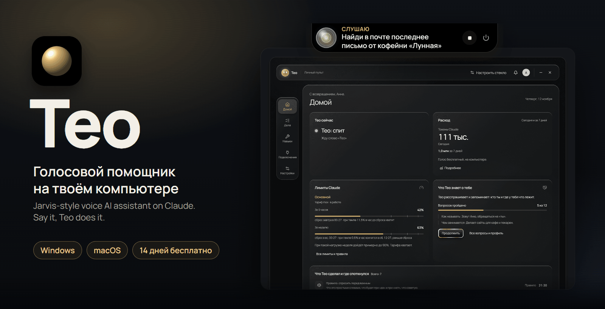
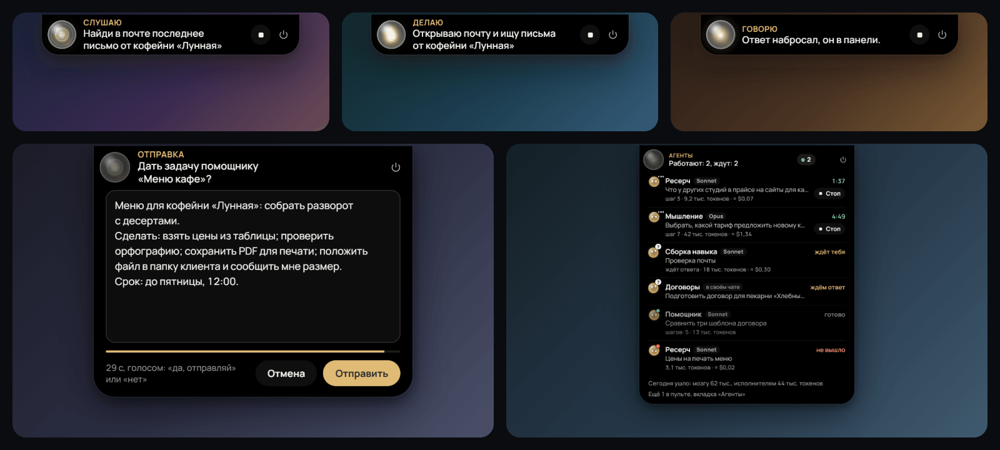
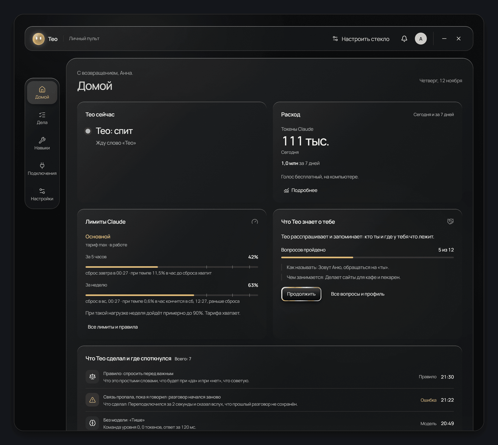
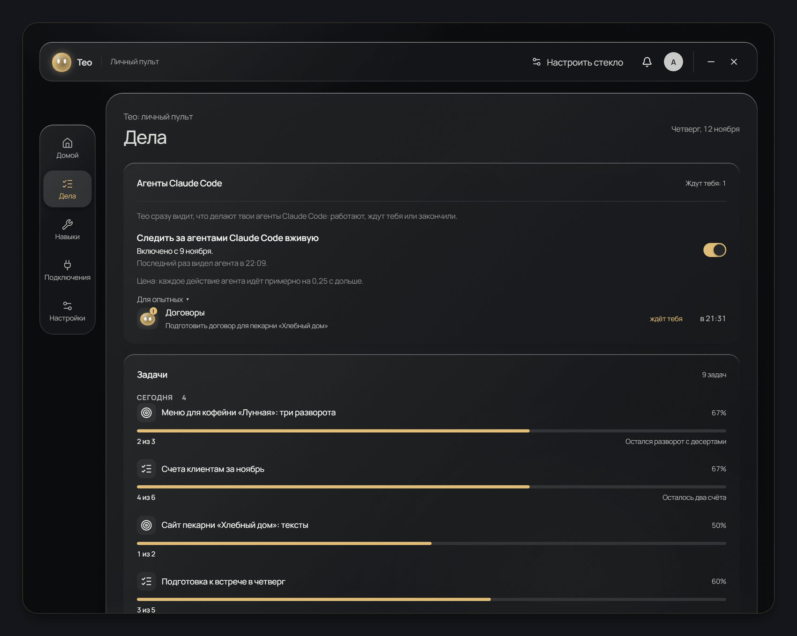
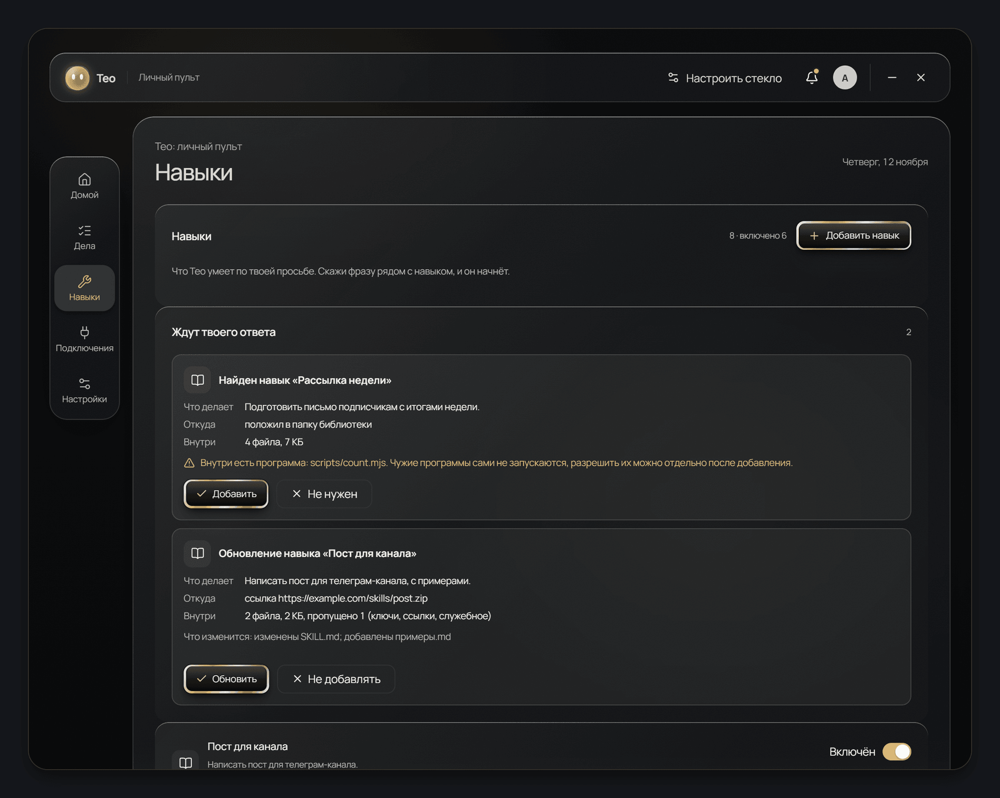
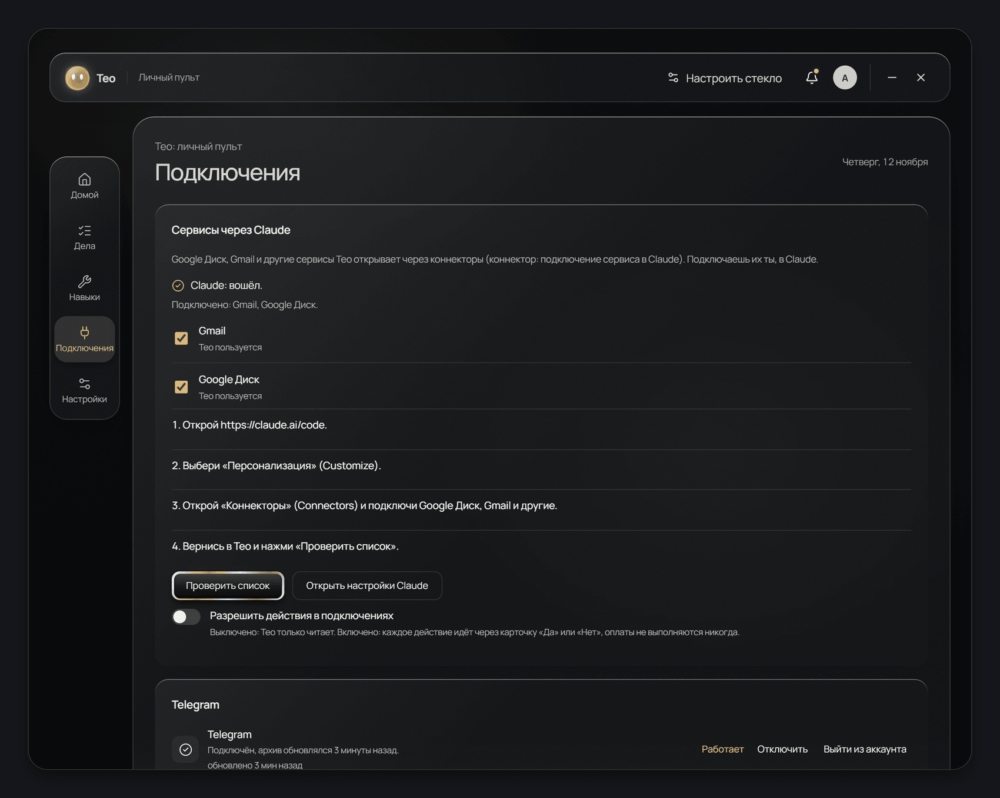
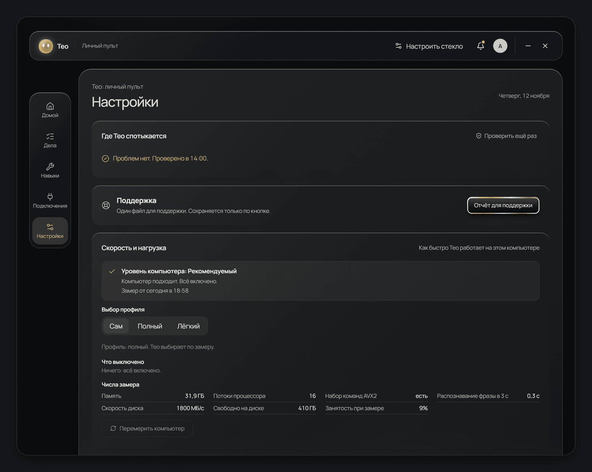

  

# Teo: a Jarvis-style voice AI assistant for your computer

**Jarvis for your own computer.** Say "Teo" and it opens apps, finds files, reads your mail or edits a spreadsheet. It runs on Claude. Windows and macOS.

Beta for early users: **14 days free, every feature included.**

**[Download the beta](https://github.com/saint4ai/teo-jarvis/releases)** · [Install](#install) · [Features](#what-teo-does) · [FAQ](docs/FAQ.en.md) · [Русский](README.md)

---

## What is Teo

Teo is a voice assistant that lives on your computer. It hears the wake word "Teo", understands speech and does the work inside your apps. The interface is in Russian today. English speech recognition works too.

Claude runs inside. You do not need a terminal, config files or permission prompts. Install Teo, sign in to Claude and talk.

- A capsule at the top of the screen shows when Teo listens, thinks or answers.
- A control panel with five buttons keeps everything in one place: Home, Tasks, Skills, Connections, Settings.
- Teo comes as a normal installer. No Python, Node or other tools to set up first.

## What Teo does

| Area | Example phrase |
|---|---|
| **Apps and windows.** Open, close, snap to a side, lower the volume | "Open Telegram", "Snap Chrome to the left" |
| **Files and documents.** Find a file, read it, edit Word and Excel, make a PDF | "Find the file contract", "Make an Excel sheet of monthly expenses" |
| **Mail and services.** Gmail, Google Drive and other services through Claude connectors | "What important mail came in", "Reply to the last client email" |
| **WhatsApp and Telegram.** Sign in with a QR code or a phone number. Teo reads chats and replies after your "yes" | "Who is waiting for a reply", "Write to Marina: I will be there in an hour" |
| **Voice messages.** Teo transcribes them and gives you the short version | "What is in Marina's voice message" |
| **Web video.** Pause, next episode, full screen on YouTube and other sites | "Pause the video", "Full screen" |
| **Memory and reminders.** Teo remembers who you are and where things live | "Remember that reports should be short", "Remind me at six to send the invoice" |
| **Claude Code agents.** See who is working, who waits for you, who is done. Approve agent requests from the capsule | "Which agents are waiting for me" |
| **Skills.** Ready-made abilities, plus new ones Teo writes for itself | "What skills do you have" |
| **Dictation into any window.** Hold a key, speak, the text lands where your cursor is | Shift and the Teo key |

Before a risky action Teo shows a card and waits for "yes" or "no". Sending messages, closing apps and cleanup happen only after you agree.

### Voice

- **"Мужской 5" (Male 5)**, the on-device voice: free, works offline. Teo downloads it on first launch.
- **ElevenLabs**: a lively cloud voice with your own key. Also needed for Kazakh.
- **Text only**: answers appear on screen, no sound.

Speech recognition runs on your computer. Languages: Russian and English. Kazakh goes through ElevenLabs with your key.

## Screenshots

All screenshots use demo data. Names, emails and numbers are made up.

| Home | Tasks |
|---|---|
|  |  |

| Skills | Connections |
|---|---|
|  |  |

## Install

### Requirements

- Windows 10 (version 1809 or newer) or 11, 64-bit. Or macOS 13 or newer on an Apple M1 chip or newer.
- A Claude Pro subscription or higher (about $20 a month on the Anthropic site). Or your own Anthropic API key.
- 8 GB of RAM and 3 GB of disk space. 16 GB and 5 GB on an SSD is better.
- A microphone and an internet connection.

Details: [docs/REQUIREMENTS.md](docs/REQUIREMENTS.md).

### Windows

1. Open [Releases](https://github.com/saint4ai/teo-jarvis/releases) and download `Teo-Setup-<version>.exe` from the latest release.
2. The browser may warn that the file is rarely downloaded. Click Keep.
3. Run the file. No administrator rights needed.
4. Windows shows "Windows protected your PC". Click "More info", then "Run anyway".
5. Wait for the install to finish. Teo opens and walks you through setup. It takes about 5 minutes.

The warning appears because the installer has no paid code signing certificate yet. The file is the same. You can verify it with the SHA-256 sum in the release notes: [how to verify](docs/FAQ.en.md#how-do-i-verify-the-file).

### macOS

1. Download the `.dmg` file from the latest release in [Releases](https://github.com/saint4ai/teo-jarvis/releases).
2. Open the image and drag Teo to Applications.
3. Launch Teo. macOS refuses because the app has no Apple signature yet.
4. Open System Settings, Privacy and Security. Scroll down.
5. Click "Open Anyway" and enter your Mac password.
6. Teo asks for microphone and other permissions one by one, when it first needs them.

### First launch

A setup wizard walks you through: computer check, microphone, wake word, Claude sign-in, voice, first command. You can skip any step and return later.

On first launch Teo downloads two models: speech recognition (about 640 MB) and memory (about 130 MB). That is about 5 minutes at 20 Mbit/s. You can go through the steps while they download.

### Connect Gmail and Google Drive

Services connect through Claude. Four steps: [docs/CONNECTORS.md](docs/CONNECTORS.md).

## Beta: 14 days free

- You need a Teo account. Sign in with Telegram.
- The trial lasts 14 days with every feature. No card needed.
- Tell us what is missing or broken in [Issues](https://github.com/saint4ai/teo-jarvis/issues/new/choose), or press "Leave feedback" in the app: Settings, Support block.
- Teo sends error reports to the developers without your conversations, files or keys. You can turn this off in Settings.

## Privacy

Memory, logs, chats and keys stay on your computer. To answer, Claude receives what you said and the parts of files, mail and pages you asked Teo to open. The cloud voice runs only with your own key.

Details: [docs/PRIVACY.md](docs/PRIVACY.md).

## Teo and other Jarvis projects

Most Jarvis projects on GitHub need to be built from source: Python, API keys, a terminal. Teo installs with an installer and guides you through setup.

Teo started as a fork of the open-source [JARVIS](https://github.com/adewaskar/jarvis) project by Aditya Dewaskar (MIT). Thank you to the author. See [NOTICE.md](NOTICE.md).

## Roadmap and docs

[Roadmap](docs/ROADMAP.md) (directions, no dates) · [Changelog](CHANGELOG.md) · [FAQ](docs/FAQ.en.md) · [Requirements](docs/REQUIREMENTS.md) · [Privacy](docs/PRIVACY.md) · [Security](SECURITY.md) · [License](LICENSE)

---

*Teo runs on Claude. Claude is a trademark of Anthropic. Teo is not affiliated with Anthropic. "Jarvis" here names a type of assistant, not a product or a character of any company. This repository holds installers and release notes. There is no Teo source code here.*
