

  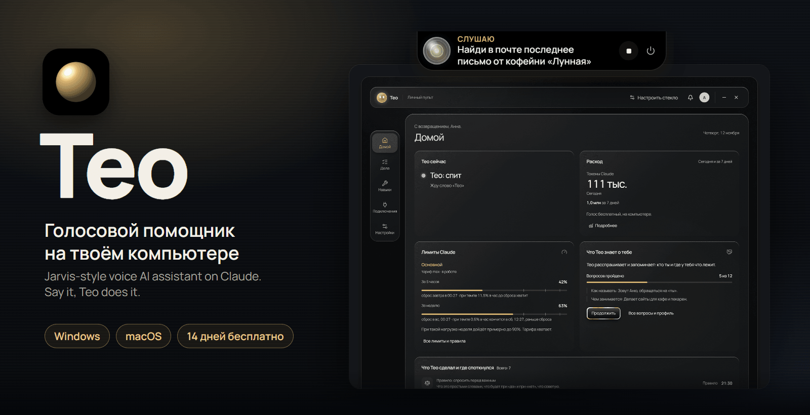

# Teo (Тео): голосовой ИИ-помощник для компьютера, как Jarvis

**Jarvis на твоём компьютере.** Скажи «Тео», и он откроет программу, найдёт файл, разберёт почту или поправит таблицу. Работает на Claude. Есть версии для Windows и macOS.

Бета 1.0.0-beta.1: **14 дней бесплатно, весь функционал. Потом $10 в месяц.** Для работы Тео нужна подписка Claude от $20 в месяц.

**[Скачать бета-версию](https://github.com/saint4ai/teo-jarvis/releases)** · [Как поставить](#как-поставить) · [Что умеет](#что-умеет-тео) · [FAQ](docs/FAQ.md) · [English](README.en.md)

---

## Что такое Тео

Тео это голосовой помощник, который живёт на твоём компьютере. Он слышит слово «Тео», понимает русскую речь и делает дела в программах.

Внутри работает Claude, через твою подписку Claude. Тебе не нужно знать терминал, настройки и разрешения. Установи Тео, войди в Claude и говори.

- Капсула вверху экрана показывает, что Тео слушает, думает или отвечает.
- Пульт на пять кнопок собирает всё в одном месте: Домой, Дела, Навыки, Подключения, Настройки.
- Тео ставится обычным установщиком. Python, Node и другие программы заранее не нужны.

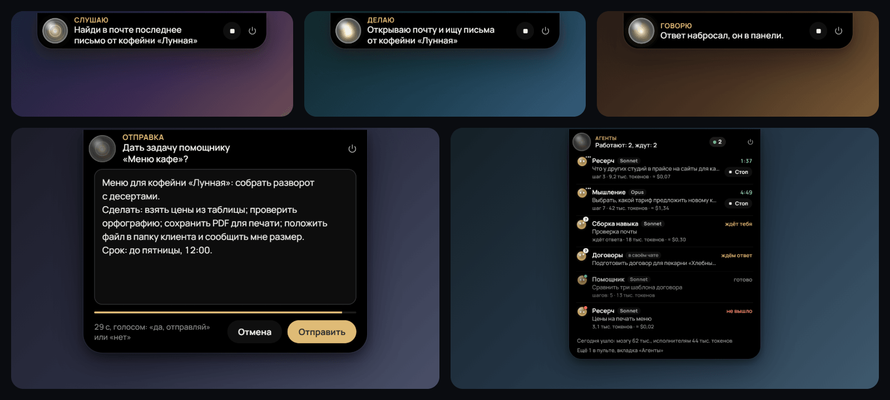

## Что умеет Тео

| Что | Как сказать |
|---|---|
| **Программы и окна.** Открыть, закрыть, прижать к краю, сделать тише | «Открой Telegram», «Прижми Chrome влево», «Сделай звук тише» |
| **Файлы и документы.** Найти файл, прочитать, править Word и Excel, собрать PDF | «Найди файл договор», «Сделай Excel-таблицу расходов за месяц» |
| **Почта и календарь.** Gmail, Яндекс и Mail.ru по паролю для программ. Календарь по ссылке | «Что важного пришло на почту», «Ответь на последнее письмо от клиента» |
| **Google Диск и другие сервисы** через коннекторы Claude | «Найди на Диске договор» |
| **WhatsApp и Telegram.** Вход по QR-коду или по номеру. Тео читает чаты и отвечает после твоего «да» | «Кто ждёт ответа», «Что писала Марина», «Напиши Марине: буду через час» |
| **Голосовые сообщения.** Тео расшифровывает их и пересказывает | «Что в голосовом от Марины» |
| **Видео на сайтах.** Пауза, следующая серия, полный экран на YouTube, Кинопоиске и других | «Поставь на паузу», «Включи на весь экран» |
| **Память и напоминания.** Тео запоминает, кто ты и где что лежит | «Запомни, что отчёты присылать коротко», «Напомни в шесть отправить счёт» |
| **Агенты Claude Code.** Видно, кто работает, кто ждёт тебя, кто закончил. Разрешения агентам можно давать из капсулы | «Кто из агентов ждёт меня» |
| **Навыки.** Готовые умения и новые, которые Тео пишет себе сам | «Какие у тебя навыки», «Научись следить за папкой» |
| **Диктовка в любое окно.** Держишь клавишу, говоришь, текст встаёт туда, где курсор | Shift и клавиша Тео |

Ясную просьбу Тео выполняет сразу. Сообщение уходит через 5 секунд, за это время его можно отменить. Удаление, деньги и установку программ Тео делает только после твоего «да» на карточке.

### Голос

- **Мужской 5** (голос на компьютере): бесплатно и без интернета. Тео скачивает его при первом запуске.
- **ElevenLabs**: живой облачный голос по твоему ключу. Нужен и для казахского языка.
- **Только текст**: ответ появляется на экране без звука.

Распознавание речи работает на компьютере. Языки: русский и английский. Казахский идёт через ElevenLabs по твоему ключу.

## Как это выглядит

**Домой.** Состояние Тео, расход, лимиты Claude, лента дел.

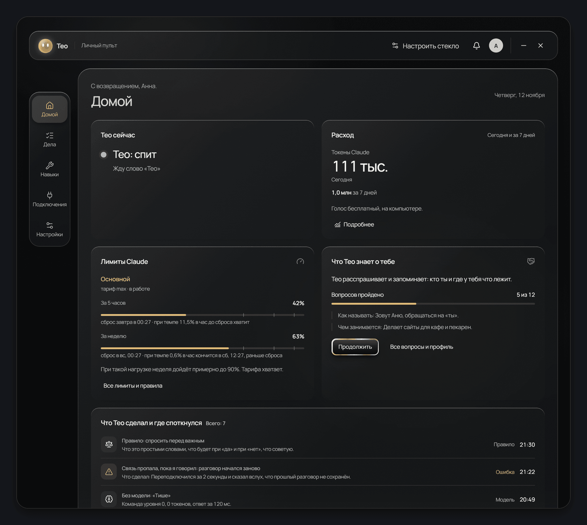

**Дела.** Задачи, агенты Claude Code, сложные вопросы, на которые Тео думает дольше.

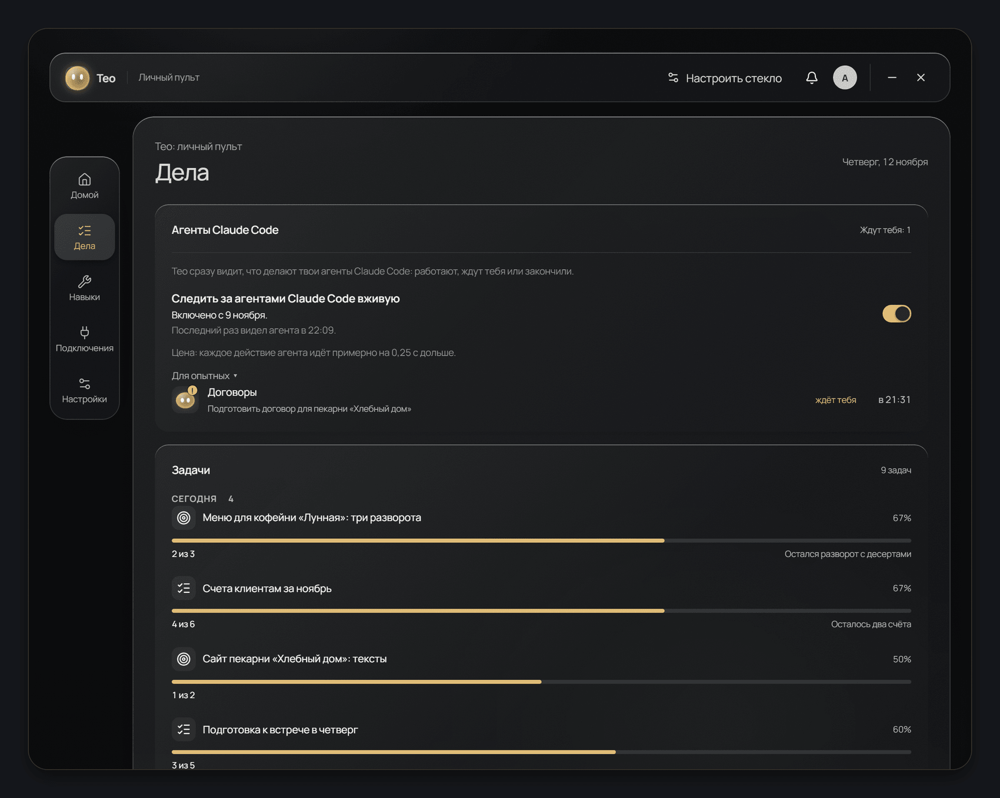

**Навыки.** Что Тео умеет по твоей просьбе. У каждого навыка есть фраза, которую можно сказать.

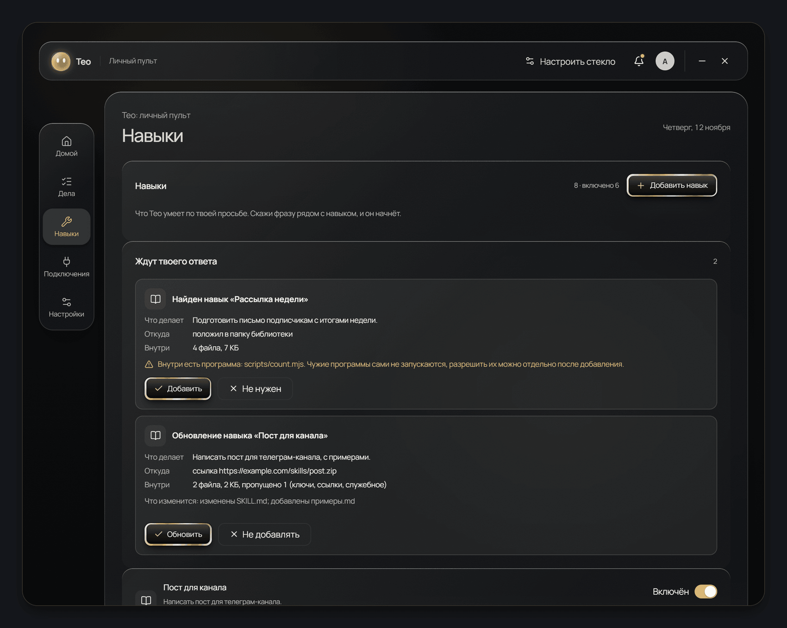

**Подключения.** Сервисы через Claude, Telegram, WhatsApp, браузер Тео.

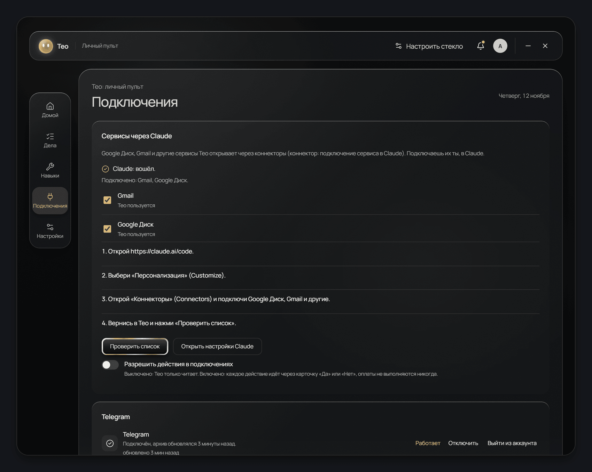

**Настройки.** Где Тео спотыкается, скорость, голос, клавиши, аккаунты, приватность.

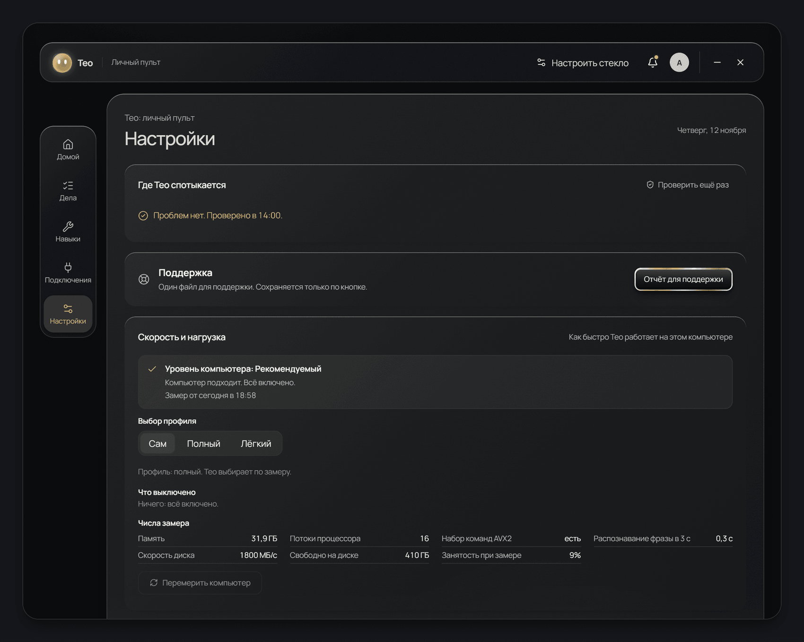

> Все снимки сделаны на демонстрационных данных. Имена, письма и цифры на них придуманы.

## Как поставить

### Что нужно

- Windows 10 (версия 1809 и новее) или 11, 64 бита. Или macOS 13 и новее на чипе Apple M1 и новее.
- Подписка Claude Pro или выше (от $20 в месяц на сайте Anthropic). Или свой ключ API Anthropic.
- 8 ГБ памяти, 3 ГБ на диске. Лучше 16 ГБ и 5 ГБ на SSD.
- Микрофон и интернет.
- Аккаунт Telegram: через него идёт вход в Тео.

Полные требования: [docs/REQUIREMENTS.md](docs/REQUIREMENTS.md).

### Windows

**1.** Открой [Releases](https://github.com/saint4ai/teo-jarvis/releases) и скачай `Teo-Setup-1.0.0-beta.1.exe`. Браузер спросит про файл: нажми «Сохранить» или «Оставить».

**2.** Запусти файл двойным щелчком. Права администратора не нужны.

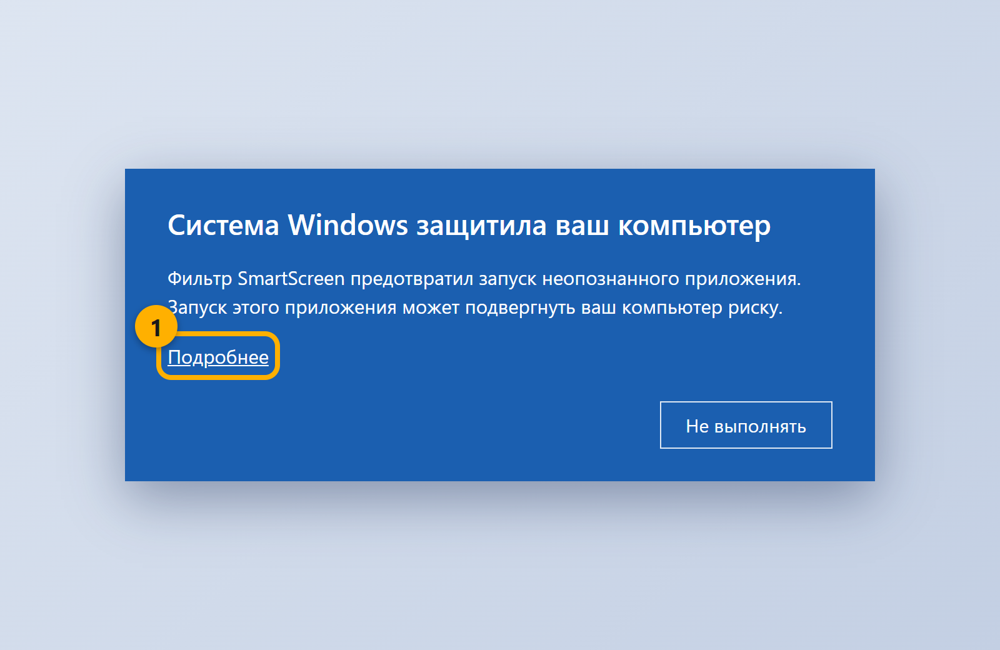

**3.** Windows предупредит о неизвестном издателе. Нажми «Подробнее».

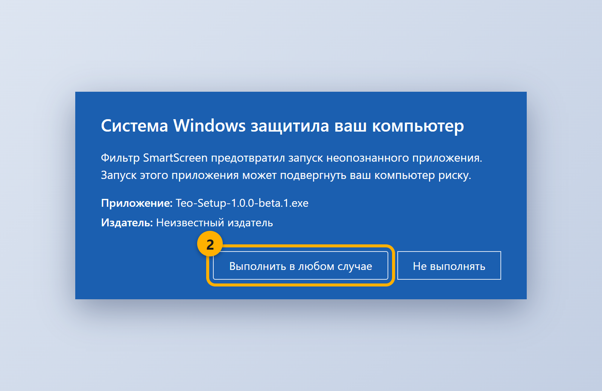

**4.** Нажми «Выполнить в любом случае».

**5.** Дождись конца установки. Тео откроется сам и проведёт по настройке. Это около 5 минут.

Окна на картинках нарисованы схемой по настоящим окнам Windows. Окно появляется, потому что у установщика пока нет платной подписи кода. Файл от этого не меняется. Проверить его можно по сумме SHA-256 из описания выпуска: [как проверить](docs/FAQ.md#как-проверить-что-файл-настоящий). Файл не открывается? [FAQ](docs/FAQ.md#установка).

### macOS

Образ для Mac кладут в выпуск отдельно от установщика Windows. Если файла `.dmg` в выпуске ещё нет, версия для Mac готовится.

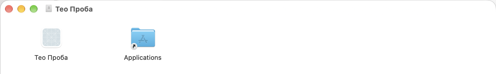

**1.** Скачай файл `.dmg` из [Releases](https://github.com/saint4ai/teo-jarvis/releases), открой и перетащи Тео в «Программы».

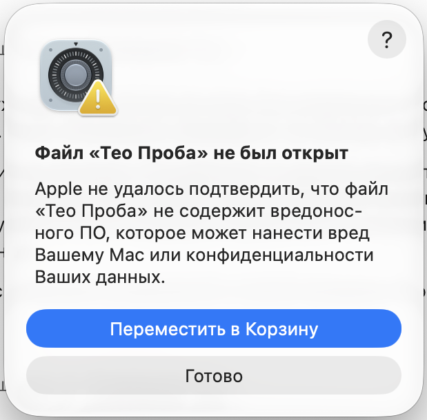

**2.** Запусти Тео. macOS предупредит, что программа не проверена. Нажми «Готово». Кнопку «Переместить в Корзину» не нажимай: она уберёт Тео.

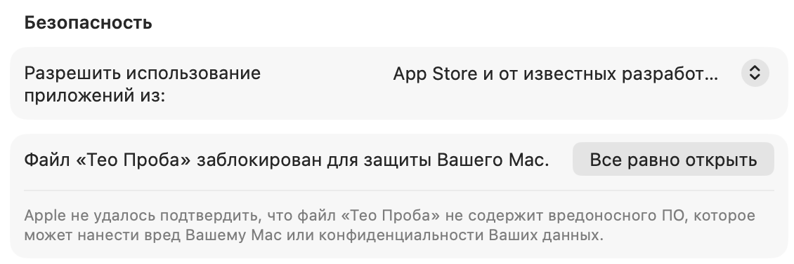

**3.** Открой «Системные настройки», «Конфиденциальность и безопасность». Прокрути вниз до «Безопасность» и нажми «Все равно открыть».

**4.** Введи пароль от Mac или приложи палец. Это нужно один раз.

На снимках стоит имя «Тео Проба»: так названа пробная программа с такой же подписью. У тебя будет «Тео». Окно с надписью «повреждено»? Нажми «OK», Тео работает. Не помогло: [подробная инструкция](docs/INSTALL-MAC.md).

После запуска macOS попросит доступ к микрофону и другим функциям по одному, в момент первой нужды.

### Первый запуск

Мастер ведёт по шагам: проверка компьютера, аккаунт Тео, микрофон, слово «Тео», вход в Claude, голос, первая команда.

**Аккаунт Тео.** Нажми «Создать аккаунт». Тео откроет страницу входа в браузере.

1. Сверь код на странице с кодом в окне Тео.
2. Поставь обе отметки: условия и оферта, обработка данных. Нажми «Продолжить».
3. Подтверди вход через Telegram. Бот входа: @teojarvis_bot.

Пароль не нужен. Пробные 14 дней начинаются с первого входа.

При первом запуске Тео докачает модели: распознавание речи около 640 МБ и память около 130 МБ. На скорости 20 Мбит/с это около 5 минут. Пока файлы качаются, шаги можно проходить.

| Мастер | Микрофон | Вход в Claude |
|---|---|---|
| 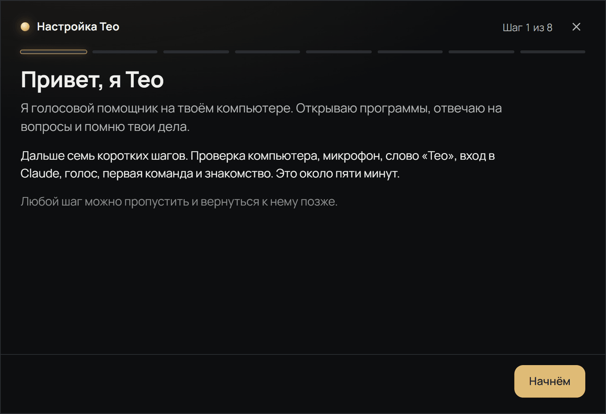 | 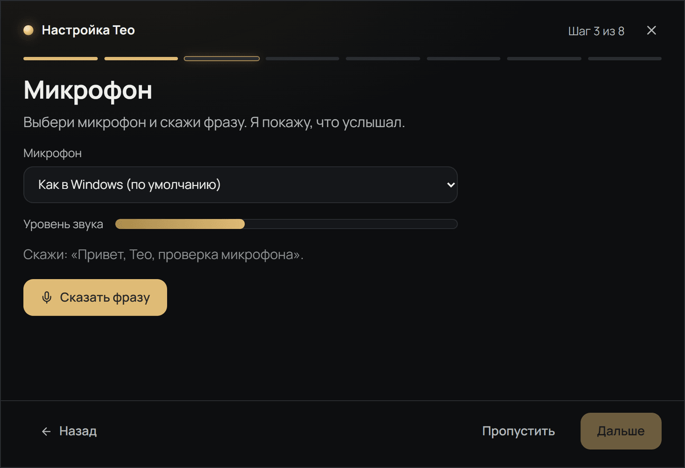 | 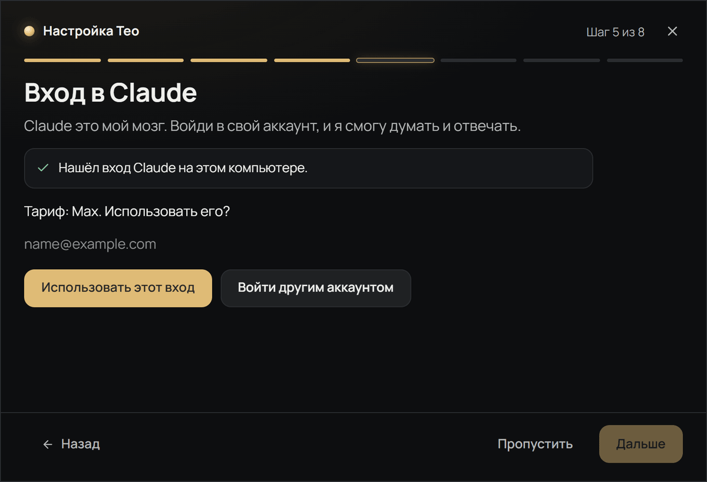 |

| Голос | Проверка и «Что я умею» |
|---|---|
| 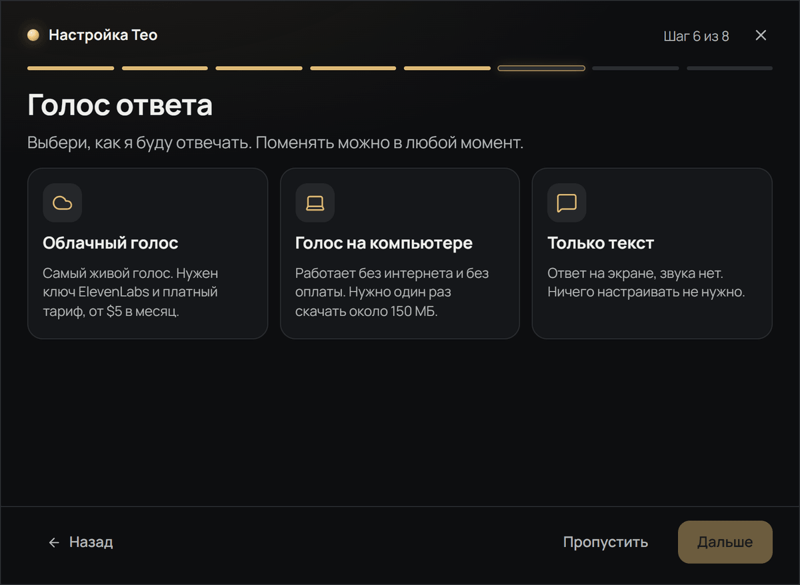 | 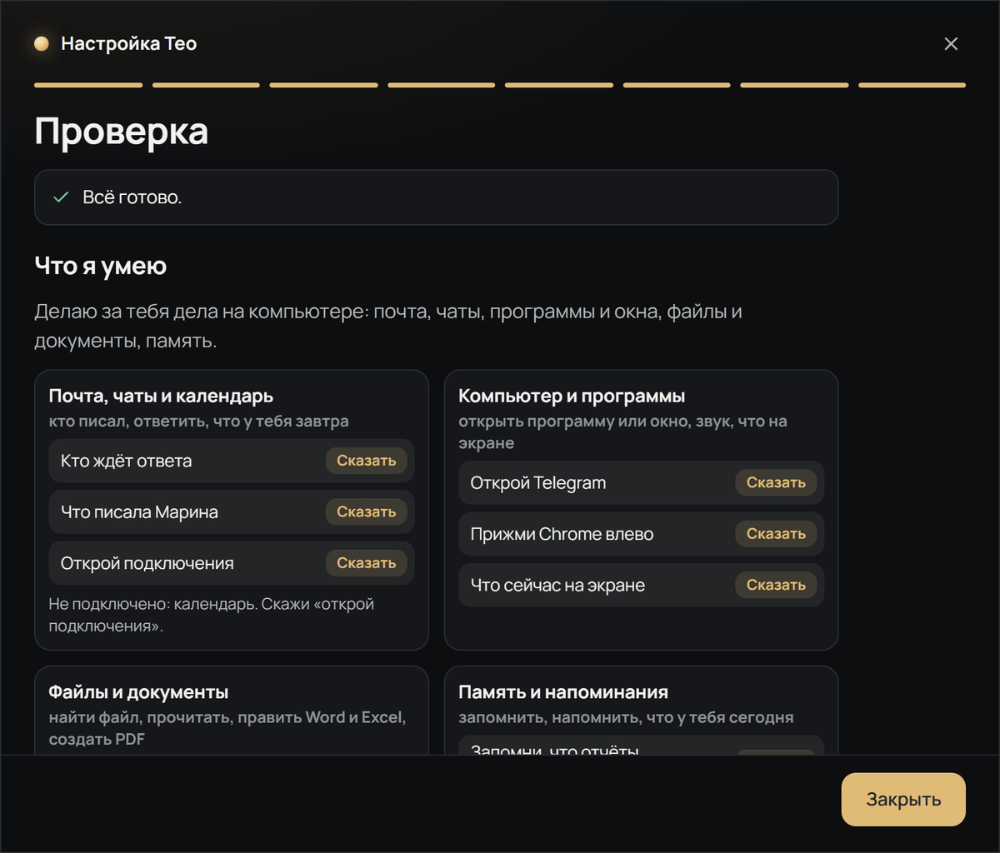 |

> Снимки мастера сняты на демонстрационных данных. В бете между приветствием и микрофоном стоит ещё шаг «Аккаунт Тео».

### Подключить Google Диск, почту и календарь

Google Диск и другие сервисы подключаются через Claude, почта и календарь отдельно. Инструкция: [docs/CONNECTORS.md](docs/CONNECTORS.md).

## Бета: 14 дней бесплатно, потом $10 в месяц

| | |
|---|---|
| **Пробный период** | 14 дней, весь функционал. Карту не просим. Начинается с первого входа в Тео |
| **Потом** | $10 в месяц, тариф один. Сумму в валюте оплаты видно на странице оплаты до оплаты. Автосписания нет: продлеваешь сам |
| **Где оплатить** | В Тео: «Настройки», раздел «Аккаунт Тео и подписка» |
| **Два способа** | «Оплата Россия»: картой банка РФ, оплата сразу. «Оплата другие страны»: картой банка не из России, ссылка на оплату приходит по СМС |
| **Вернуть деньги** | Вернём за дни, которые ещё не наступили. Условия в [оферте](https://teo.onai.academy/terms) |
| **После 14 дней без оплаты** | Ответы ИИ выключаются. Команды без ИИ, память и настройки остаются |
| **Компьютер** | Один аккаунт, один компьютер. Перенести можно раз в 30 дней |

Аккаунт, подписку и платежи видно на странице [teo.onai.academy/account](https://teo.onai.academy/account). Там же можно отвязать компьютер и удалить аккаунт.

## Поддержка

- Почта: [saint4aiinst@gmail.com](mailto:saint4aiinst@gmail.com). Назови номер аккаунта: он на странице аккаунта.
- Форма «Оставить отзыв» в Тео: «Настройки», блок «Поддержка». Туда же пиши идеи.
- Ошибки Тео отправляет разработчикам сам, без твоих разговоров, файлов и ключей. Это выключается в «Настройках», блок «Приватность».

## Приватность

Память, журнал, переписки и ключи лежат на твоём компьютере. Для ответа Claude получает то, что ты сказал, и куски файлов, писем и страниц, к которым ты попросил обратиться. Облачный голос работает только по твоему ключу.

Подробно: [docs/PRIVACY.md](docs/PRIVACY.md). Полная политика на сервере Тео: [teo.onai.academy/privacy](https://teo.onai.academy/privacy).

## Тео и другие проекты Jarvis

Большинство Jarvis на GitHub нужно собирать из кода: Python, ключи API, терминал. Тео ставится установщиком, говорит по-русски и ведёт по настройке сам.

Тео начинался как форк открытого проекта [JARVIS](https://github.com/adewaskar/jarvis) Адитьи Девашкара (MIT). Спасибо автору. Подробнее в [NOTICE.md](NOTICE.md).

## Дорожная карта

Направления без обещания сроков: [docs/ROADMAP.md](docs/ROADMAP.md). История версий: [CHANGELOG.md](CHANGELOG.md).

## Документы

| | |
|---|---|
| [FAQ](docs/FAQ.md) | Цена и оплата, предупреждения Windows и macOS, микрофон, удаление, проверка файла |
| [Установка на Mac](docs/INSTALL-MAC.md) | Шаги со снимками и что делать, если окно пишет «повреждено» |
| [Требования](docs/REQUIREMENTS.md) | Железо и системы |
| [Подключения](docs/CONNECTORS.md) | Как подключить Google Диск, почту и календарь |
| [Приватность](docs/PRIVACY.md) | Что уходит из компьютера, что остаётся |
| [Оферта](https://teo.onai.academy/terms) и [политика](https://teo.onai.academy/privacy) | Полные тексты, есть казахская версия |
| [Безопасность](SECURITY.md) | Как сообщить об уязвимости |
| [Лицензия](LICENSE) | Условия использования, черновик |
| [Описания версий](channels/README.md) | Как Тео узнаёт об обновлениях |

---

*Тео работает на Claude. Claude: товарный знак Anthropic. Тео не связан с Anthropic. Слово «Jarvis» здесь значит тип помощника, а не продукт или персонажа какой-либо компании. В этом репозитории лежат установщики и описания, исходного кода Тео здесь нет.*
