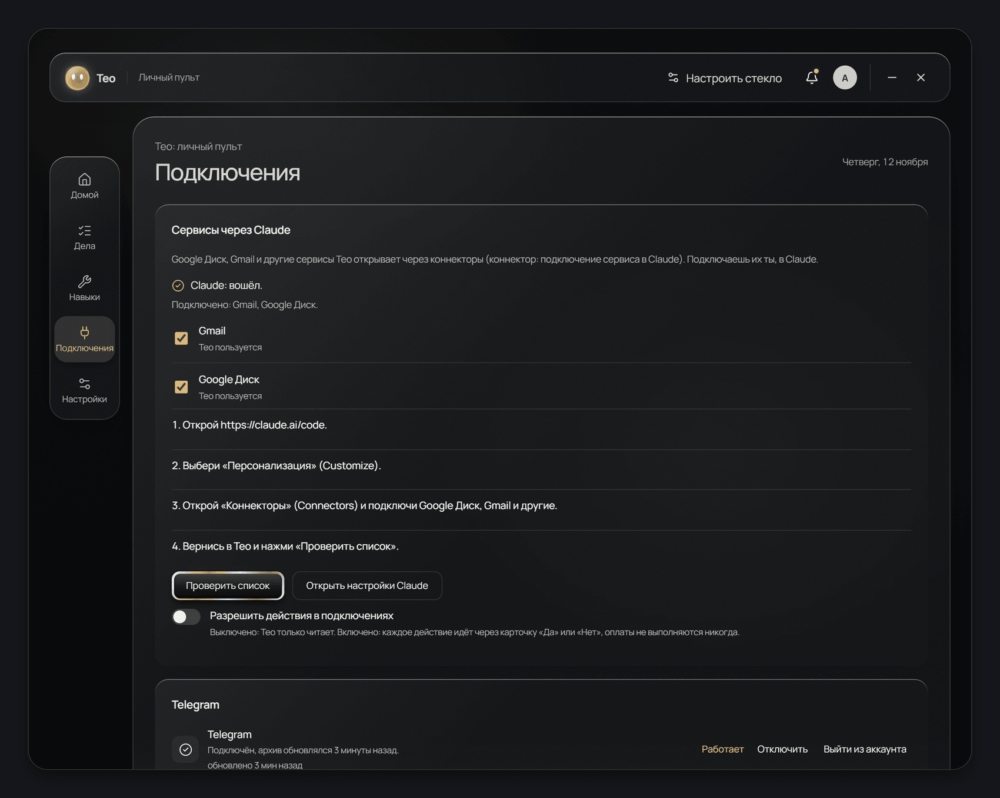

# Как подключить Gmail, Google Диск и другие сервисы / Connect Gmail, Google Drive and other services

[Назад к README](../README.md) · [Back to README](../README.en.md)

## По-русски

Тео открывает сервисы через коннекторы Claude. Коннектор это подключение сервиса в твоём аккаунте Claude. Пароли от почты Тео не просит.

### Четыре шага

1. Открой https://claude.ai/code. Это можно сделать кнопкой «Открыть настройки Claude» в Тео: пульт, «Подключения».
2. Выбери «Персонализация» (Customize).
3. Открой «Коннекторы» (Connectors) и подключи Google Диск, Gmail и другие сервисы.
4. Вернись в Тео и нажми «Проверить список».

Тео перечитает коннекторы и покажет, какие подключены. Напротив каждого сервиса стоит отметка «Тео пользуется» или «Тео не пользуется». Её можно менять.

### Если у тебя ещё нет Claude

Мастер первого запуска ведёт на вход в Claude. Потом работает тот же маршрут из четырёх шагов.

### Действия в сервисах

По умолчанию Тео только читает. Переключатель «Разрешить действия в подключениях» включает действия. Каждое действие идёт через карточку «Да» или «Нет». Оплаты Тео не выполняет никогда.

### Telegram и WhatsApp

Вход по QR-коду или по номеру телефона. Раздел «Подключения», блоки Telegram и WhatsApp.

### Браузер Тео

Отдельный браузер с отдельным профилем. Входы в нём хранятся только на этом компьютере. Тео сможет делать в нём всё, что ты попросишь, от твоего имени. Перед первым открытием Тео предупредит об этом.

## In English

Teo opens services through Claude connectors. A connector is a service connection inside your Claude account. Teo never asks for your mail password.

### Four steps

1. Open https://claude.ai/code. You can use the "Open Claude settings" button in Teo: control panel, Connections.
2. Choose "Customize".
3. Open "Connectors" and connect Google Drive, Gmail and other services.
4. Return to Teo and press "Check list".

Teo rereads the connectors and shows which ones are connected. Each service has a "Teo uses it" or "Teo does not use it" mark. You can change it.

### If you do not have Claude yet

The first-run wizard leads you through the Claude sign-in. Then the same four steps apply.

### Actions inside services

By default Teo only reads. The switch "Allow actions in connections" turns actions on. Every action goes through a "Yes" or "No" card. Teo never makes payments.

### Telegram and WhatsApp

Sign in with a QR code or a phone number. Connections screen, Telegram and WhatsApp blocks.

### The Teo browser

A separate browser with its own profile. Sign-ins stay on this computer only. Teo can do anything you ask in it on your behalf. Teo warns you before the first launch.
