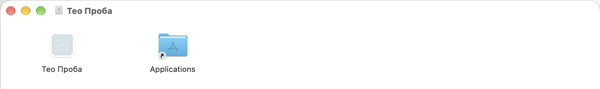
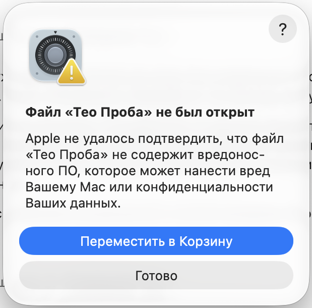
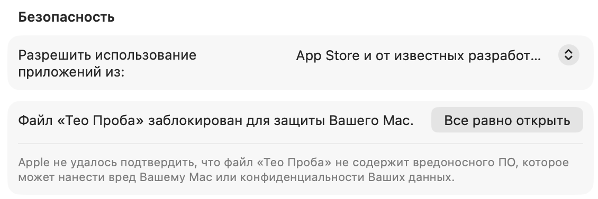

# Installing Teo on Mac

[Русская версия](INSTALL-MAC.md) · [Back to README](../README.en.md)

You need a Mac with an Apple chip (M1 or newer) and macOS 13 or newer. Teo comes as a `.dmg` file from [Releases](https://github.com/saint4ai/teo-jarvis/releases).

The Mac image is added to the release separately from the Windows installer. If there is no `.dmg` file there yet, the Mac version is being prepared.

The screenshots were taken on macOS with the Russian interface, on a trial app named "Тео Проба" with the same signature as Teo. That is why the windows show this name. You will see "Тео". On other macOS versions the wording in the windows may differ. The order of steps is the same.

## Steps

**1. Download the image.** Take the `.dmg` file from the latest release.

**2. Move Teo to Applications.** Double-click the `.dmg`. A window opens with Teo and an Applications folder. Drag Teo into the folder.



**3. Open Teo from Applications.** Double-click it. macOS does not know the app yet and shows a window: Apple could not verify that the file is free of malware.



Click "Done". Do not click the button that moves Teo to the Bin: it removes Teo.

**4. Allow it in settings.** Open System Settings, Privacy and Security. Scroll down to the Security section. You will see a line saying the file was blocked to protect your Mac, with an "Open Anyway" button. Click it.



**5. Confirm.** macOS asks for your Mac password or Touch ID. Enter it. Teo starts.

You do this once. After that Teo opens like any other app.

After launch macOS asks for permissions one by one, when Teo first needs them. The microphone is required, the rest is optional.

## If a window says "damaged"

Sometimes 3 or 4 seconds after launch macOS shows a window saying the app is damaged, with "OK" and "Show in Finder" buttons. Teo is running, nothing is broken. Click "OK".

## If Teo did not open

The window keeps getting in the way, or Teo did not start? Remove the block with one command. Open Terminal, paste the line and press Return:

```
xattr -dr com.apple.quarantine "/Applications/Тео.app"
```

Then open Teo from Applications again. The first window will not return.

## Why

Teo is not from the App Store, and during the beta it has no Apple signature. macOS warns about every such app downloaded in a browser. The warning does not mean the file is infected. It means Apple has not checked it. The SHA-256 sum of the file is in the release notes: [how to verify](FAQ.en.md#how-do-i-verify-the-file).
