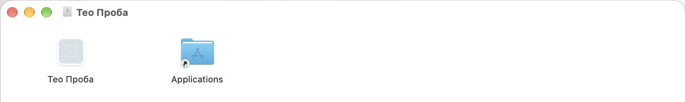
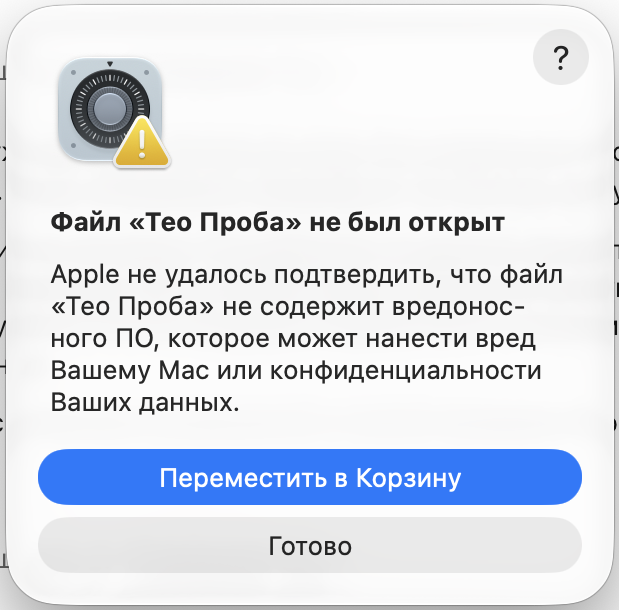
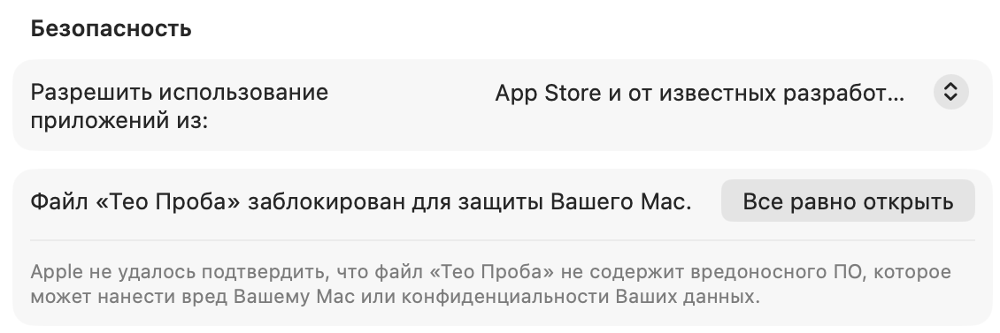

# Установка Тео на Mac

[English version](INSTALL-MAC.en.md) · [Назад к README](../README.md)

Нужен Mac с чипом Apple (M1 и новее) и macOS 13 или новее. Тео ставится файлом `.dmg` из [Releases](https://github.com/saint4ai/teo-jarvis/releases).

Образ для Mac кладут в выпуск отдельно от установщика Windows. Если файла `.dmg` там ещё нет, версия для Mac готовится.

Снимки сняты на macOS с русским интерфейсом, на пробной программе «Тео Проба» с такой же подписью, как у Тео. В окнах поэтому стоит это имя, у тебя будет «Тео». На другой версии macOS слова в окнах могут отличаться, порядок шагов тот же.

## Шаги

**1. Скачай образ.** Возьми файл `.dmg` из последнего выпуска.

**2. Перенеси Тео в «Программы».** Двойной щелчок по `.dmg` открывает окно с Тео и папкой «Программы». Перетащи Тео в папку.



**3. Запусти Тео из «Программ».** Двойной щелчок. macOS не знает программу и покажет окно: Apple не удалось подтвердить, что файл не содержит вредоносного ПО.



Нажми «Готово». Кнопку «Переместить в Корзину» не нажимай: она уберёт Тео.

**4. Разреши запуск в настройках.** Открой «Системные настройки», «Конфиденциальность и безопасность». Прокрути вниз до раздела «Безопасность». Там строка «Файл заблокирован для защиты Вашего Mac» и кнопка «Все равно открыть». Нажми её.



**5. Подтверди.** macOS попросит пароль от Mac или Touch ID. Введи пароль или приложи палец. Тео запустится.

Это нужно один раз. Дальше Тео открывается как обычная программа.

После запуска macOS попросит разрешения по одному, в момент первой нужды. Микрофон нужен обязательно, остальные по желанию.

## Если в окне написано «повреждено»

Иногда через 3 или 4 секунды после запуска macOS показывает окно «Приложение повреждено» с кнопками «OK» и «Показать в Finder». Тео при этом работает, ничего не сломано. Нажми «OK».

## Если Тео так и не открылся

Окно мешает или Тео не запустился? Сними блокировку одной командой. Открой «Терминал», вставь строку и нажми Return:

```
xattr -dr com.apple.quarantine "/Applications/Тео.app"
```

Потом снова запусти Тео из «Программ». Окно «не был открыт» больше не появится.

## Почему так

Тео не из App Store, и на этапе беты у него нет подписи Apple. macOS предупреждает о каждой такой программе, когда её скачали из браузера. Предупреждение не значит, что файл заражён. Оно значит, что Apple его не проверяла. Сумма SHA-256 файла записана в описании выпуска: [как проверить](FAQ.md#как-проверить-что-файл-настоящий).
